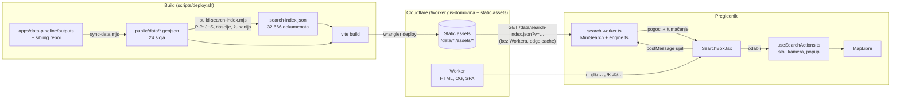
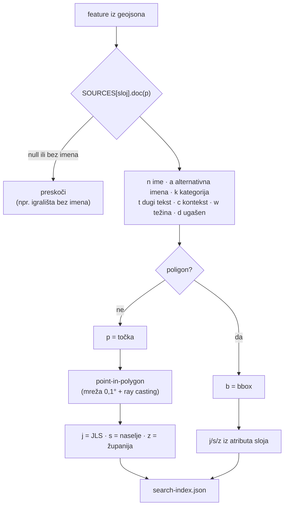
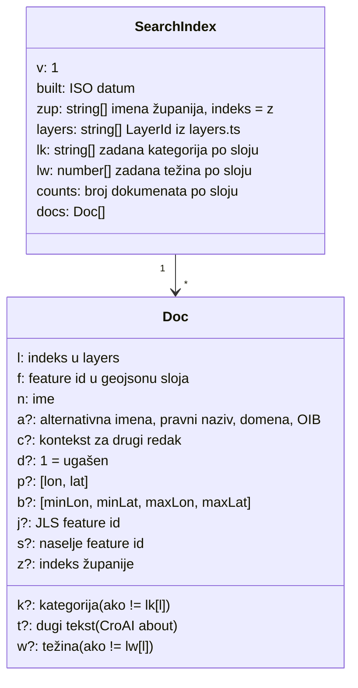
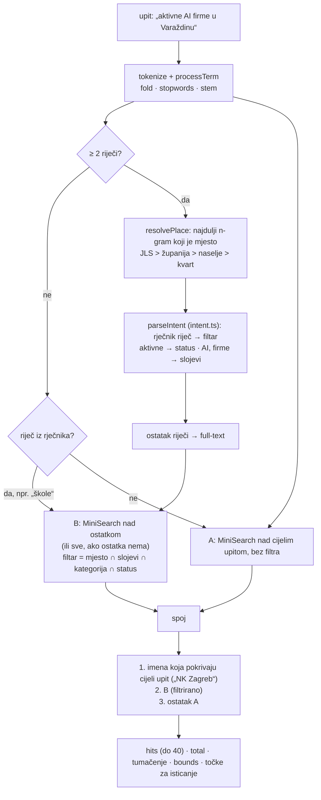
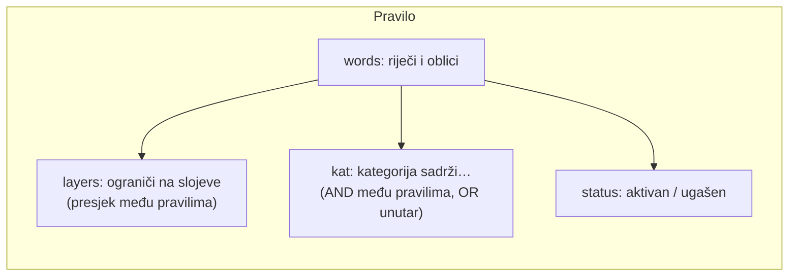
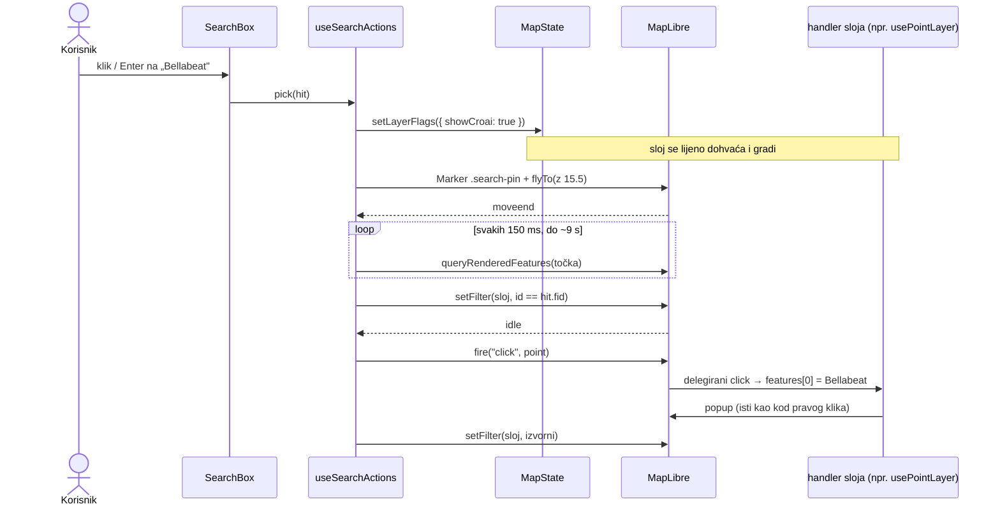
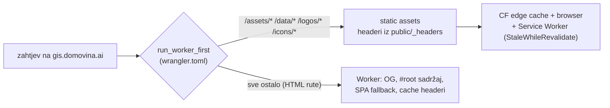
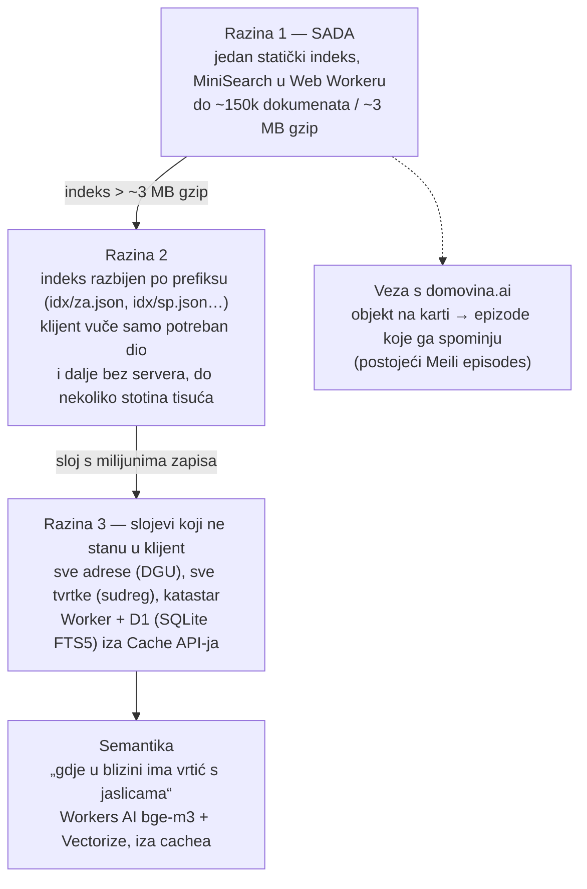

# Tražilica kroz sve slojeve karte (2026-10-30)

Pretraga na gis.domovina.ai traži kroz **sve slojeve** (32.666 objekata u 24
sloja), a ne samo JLS-ove i naselja. Razumije upite poput „AI firme za
zdravstvo u Zagrebu", „škole u Splitu" ili „vrtići Sesvete", radi bez
dijakritika („cakovec", „djakovo") i ne treba server ni bazu: indeks je
statička datoteka, a upiti se izvršavaju u pregledniku, u Web Workeru.

Prvi slučaj uporabe bio je sloj **CroAI**. Svih 565 subjekata može se tražiti
po imenu, pravnom nazivu, domeni weba, OIB-u, kategoriji, opisu
(engleski `about`), mjestu, veličini (FINA) i statusu.

| | |
|---|---|
| Indeks | `public/data/search-index.json`: 5,0 MB sirovo, 1,15 MB gzip, ~720 KB brotli |
| Kada se učitava | na prvi fokus polja za pretragu, ne pri otvaranju karte |
| Izgradnja indeksa u pregledniku | ~300 ms (M-čip), u Web Workeru |
| Trajanje upita | 0–12 ms |
| Trošak po upitu | 0 (nema poziva na server) |
| Kod | `src/search/`, `scripts/build-search-index.mjs`, `src/components/SearchBox.tsx` |

## 1. Arhitektura



Zašto ovako, a ne Meilisearch, SearXNG ili baza:

- **Svi podaci karte stanu u preglednik.** 32 tisuće imena s kontekstom
  komprimirana su manja od jednog `crkve.geojson`. Server ne bi bio brži,
  samo bi postao točka kvara i trošak koji raste s prometom.
- **SearXNG** je metatražilica nad Googleom i Bingom, a naše podatke ne
  indeksira. Za ovaj problem ne vrijedi.
- **Meilisearch i ClickHouse na Coolifyju** (domovina.ai, domovina-rag)
  imaju smisla za ono što ne stane u klijent: transkripte, milijune adresa,
  semantiku. Vidi poglavlje 7.

## 2. Indeks: kako nastaje

`scripts/build-search-index.mjs` čita geojsone i za svaki sloj iz tablice
`SOURCES` izvlači dokument. Novi sloj na karti treba jedan unos u toj tablici.



Lokacija se računa point-in-polygonom jer slojevi „gdje je" pišu na pet
različitih načina (`municipality`, `jls`, `mjesto`, `city`, ili nikako). Filtar
„u Sesvetama" mora raditi jednako za CroAI firmu, vrtić i župu.

### Format



Sloj, zadana kategorija i zadana težina nisu ponovljeni u svakom
dokumentu. To je smanjilo indeks sa 6,5 na 5,0 MB. MiniSearch indeks se
namjerno ne serijalizira u buildu: bio bi nekoliko puta veći od dokumenata,
a izgradnja u Workeru traje 300 ms.

### Težine (rang između slojeva)

| Sloj | Težina | Napomena |
|---|---|---|
| Županija | 3 | |
| Grad / općina | 2,6 / 2,2 | |
| Naselje | 0,9–1,9 | raste s log(stanovništva) |
| CroAI | 1,35–2,0 | tvrtke 1,5 + log(FINA zaposleni), pa su Ericsson NT, Infobip i Končar prvi za „ai firme" |
| Privatni ekosustav | 1,5 | |
| Klubovi | 1,0–1,8 | raste s ligaškim rangom |
| Škole, ustanove, župe | 0,9–1,0 | |
| Crkve, vrtići | 0,7 | |
| ZG stajališta, spremnici, WiFi | 0,35 | 2.700 stajališta inače preplave rezultate |

Ugašeni subjekt (FINA ili registar) ima pola težine i prikazuje se precrtano.

## 3. Upit: tok kroz engine

`src/search/engine.ts` je čista klasa bez DOM-a i Reacta. Ista radi u Web
Workeru i u Nodeu (`npm run search-smoke`).



### Normalizacija (`normalize.ts`)

Ista funkcija vrijedi za indeks i za upit, inače se tokeni ne sretnu.

| Korak | Primjer |
|---|---|
| fold: mala slova, bez dijakritika | Čakovec → cakovec |
| `dj` → `d` (na obje strane) | djakovo = Đakovo |
| stopwords (HR + EN) | u, na, za, kod, the, and… |
| lagani stem (5+ slova) | Zagrebu → zagreb, Splitu → split, startupi → startup |
| sibilarizacija | Rijeci → rijek = Rijeka → rijek |

Stem nije lingvistički točan i ne treba biti: dovoljno je da oba oblika iste
riječi završe u istom korijenu. Popis nastavaka je kratak jer svaki dodani
nastavak spaja i riječi koje ne bi smjele biti iste.

### MiniSearch postavke

| | |
|---|---|
| Polja i boost | ime 5 · alternativna imena 2 · kategorija 1,5 · kontekst 1 · opis 0,4 |
| Prefiks | zadnja riječ uvijek (tipkanje u tijeku), ostale od 4 slova |
| Fuzzy | od 5 slova, 20 % (1 tipfeler na 5 slova) |
| Kombinacija | AND; ako nema pogodaka, OR |
| `boostDocument` | težina × (0,5 ako je ugašen) × blizina središta karte (zoom ≥ 8) |

### Rječnik (`intent.ts`)



| Upit | Pravila | Filtar |
|---|---|---|
| AI | `AI` | slojevi croai, ekosustav |
| firme, startupi | `tvrtke` | slojevi croai, ekosustav, inkubatori |
| zdravstvo | `zdravstvo` | kategorija ∋ healthcare, zdravstven, ljekarna, dom zdravlja |
| investitori | `investitori` | kategorija ∋ investor, fond |
| aktivne | `aktivni` | d ≠ 1 |
| škole | `škole` | kategorija ∋ skola, gimnazija |
| župe | `župe` | sloj zupe |

CroAI kategorije su u izvoru na engleskom (`Healthcare & Life Sciences`), a
ljudi pitaju na hrvatskom. Rječnik je most između toga. Engleski upiti
(„computer vision", „chatbot") rade i bez njega, preko `about` teksta.

Usporedba je **jednakost korijena**; prefiks vrijedi samo za korijene od 6+
slova, jer bi „zupa" kao prefiks progutao „županija".

### Mjesta

`resolvePlace` traži najdulji n-gram (do 3 riječi) koji je ime mjesta:

- prednost redom: JLS, županija, naselje, kvart;
- naselje bez prijedloga pred sobom vrijedi samo ako ima oko 1000+ stanovnika
  (težina ≥ 1,4). Inače bi „Luka", „Draga" ili „Most" postali filtar. S
  prijedlogom („u Lugu") vrijede sva naselja;
- kvart je zadnji jer je njegov filtar bbox, a bbox četvrti Sesvete pokupi i
  Dugo Selo.

Mjesto i rječnik se primjenjuju tek kad upit ima **dvije ili više riječi**.
„Split" sam je običan upit (JLS Split na vrhu), „škole Split" je filtar.

## 4. Odabir rezultata



- **Popup se otvara sintetičkim klikom, ne kopijom `popupHtml`-a.** Svaki sloj
  već ima svoj popup (klubovi i modal), i jedini način da pretraga i klik
  pokažu isto jest da pretraga klikne.
- **Filtar na ciljani feature prije klika** postoji jer više točaka zna
  stajati na istom mjestu. CroAI firme bez adrese su u središtu naselja, pa
  bi klik na Bellabeat otvorio CVCA. E2e test je to uhvatio.
- JLS, naselje i županija idu postojećim putem (odabir, fokus, fit), kao
  prije.
- Poligonski slojevi (kvartovi, četvrti, biskupije): sloj se upali i kamera
  stane na bbox.

### „Prikaži sve na karti"

Za upit-filtar („AI startupi Split") gumb pali slojeve svih pogodaka, crta
žuti prsten ispod svake točke (`hr-search-hits-halo`, do 3000 točaka) i stane
na obuhvat. Prsten je ispod točaka sloja, pa klik i dalje ide na pravu točku.
Brisanje upita briše prstene.

## 5. Troškovi i serviranje



Prije ove promjene `run_worker_first = true` je kroz Worker slao **svaki**
zahtjev, i svaki geojson, svaki JS chunk i svaki logo trošio je jedan poziv
Workera. Sad Worker pokreću samo HTML rute (jedan zahtjev po otvaranju
stranice). Datoteke idu ravno iz asseta, a takvi zahtjevi se ne broje u
kvotu poziva Workera.

Posljedice:

- Pretraga ne radi nijedan zahtjev po upitu. Indeks se dohvaća jednom (i
  nakon toga je u cacheu Service Workera), a trošak ne raste s brojem
  upita ni posjetitelja.
- Headeri za te datoteke sad dolaze iz `public/_headers`, ne iz
  `applyCacheHeaders` u `_worker.js`. **Vrijednosti moraju ostati iste na oba
  mjesta.** `_headers` je izbačen iz `.assetsignore`, da ga wrangler pročita.
- Nepostojeća datoteka pod `/data/` sad dobije SPA fallback (index.html, 200),
  a ne 404 iz Workera. Klijent traži samo datoteke s `?v=<build>`, koje u tom
  deployu postoje, pa se to u praksi ne događa.

Provjera nakon deploya:

```bash
curl -sI "https://gis.domovina.ai/data/search-index.json" | grep -iE "cache-control|content-encoding|x-runtime"
# cache-control: public, max-age=3600, must-revalidate
# x-runtime NE smije postojati (to postavlja samo Worker)
curl -sI "https://gis.domovina.ai/" | grep -i x-runtime   # x-runtime: worker
```

## 6. Kako dodati…

**Novi sloj u pretragu:** unos u `SOURCES` (`scripts/build-search-index.mjs`).
`layer` mora biti `LayerId` iz `src/lib/layers.ts`, jer se preko njega pali
prekidač i nalazi ikona. Ako je sloj točkast i ima popup, dodaj id njegova
MapLibre circle sloja u `CIRCLE` (`src/search/useSearchActions.ts`).

**Nove riječi u rječnik:** pravilo u `RULES` (`src/search/intent.ts`). Navedi
oblike riječi koje ljudi stvarno pišu. Usporedba je po korijenu, pa padeži
uglavnom dođu sami.

**Provjera rangiranja bez preglednika:**

```bash
npm run build-search                      # nakon sync-data
npm run search-smoke                      # ~30 referentnih upita
npm run search-smoke -- "ai firme osijek" "rimac"
```

**E2e:** `e2e/search.spec.ts` (tumačenje CroAI upita, popup odabrane firme,
„porec", „Prikaži sve na karti").

## 7. Kako raste dalje



Okidač za razinu 2 je veličina indeksa (`build-search-index.mjs` je ispisuje
pri svakom deployu), a ne broj posjetitelja. Na razini 3 trošak raste s brojem
**različitih** upita, ne s brojem posjetitelja, jer popularne upite poslužuje
edge cache.
