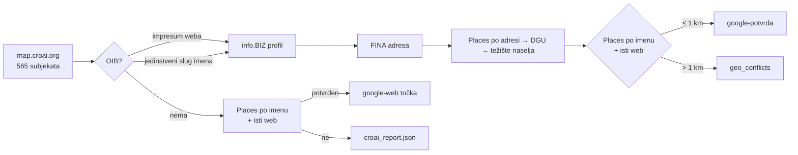

# Sloj AI ekosustav (CroAI) — 29.10.2026.

Sloj `croai` na gis.domovina.ai prikazuje Croatian AI Landscape s
map.croai.org. Gradi ga `apps/data-pipeline/scripts/34_fetch_croai.py`, a
frontend je `apps/karta-web/src/hooks/useCroaiLayer.ts`. Prvi build: **301 od
565** subjekata na karti. Lokalno je provjeren, **nije deployan**.

## Imenik nije članstvo

CroAI u pozivu za 5. izdanje mape (mail s `clanstvo@croai.org`, 29.10.2026.)
piše da je unos u imenik odvojen od formalnog članstva u udruzi. Na mapi su
A1, Addiko, 24sata, konferencije i sveučilišta, a privatnih članova nema. Zato
se sloj zove „AI ekosustav (CroAI)“, ne „članovi CroAI-ja“. Za upis na mapu
CroAI koristi Google Form iz tog maila.

## Izvor nema adrese

`POST https://map.croai.org/api/fetchEntities` s tijelom
`{"tableId":"tblCgVtW6pcjIja5q","baseId":"app2Fy0c82KqBtG0N"}` vraća stablo
od 3 grupe (Startups & Companies, Enablers & Extended Ecosystem, Early
Adopters), 27 potkategorija i 565 subjekata. Subjekt ima samo `name`,
`domain`, `logoURL`, `about` i `yearFounded`. `logoURL` je potpisani Airtable
URL koji istječe za nekoliko sati, pa se ne sprema.

Bez adrese sam geokoding ne pomaže. Lokacija ide preko identiteta (OIB), kao u
koraku 33.

## Kako se traži OIB, i zašto baš tako

1. **Impresum vlastitog weba.** Naslovnica i do 5 podstranica čiji put zvuči
   kao impresum, kontakt, o nama ili pravne informacije. OIB mora proći
   kontrolnu znamenku i postojati u info.BIZ indeksu. Označeni broj („OIB:“,
   „VAT“) vrijedi 3, goli broj 1. Kad stranica ima više OIB-a, pobjeđuje onaj
   čiji info.BIZ slug liči na ime ili domenu.
2. **Jedinstveni slug imena u info.BIZ indeksu** (318 899 subjekata).
   „Addiko Bank d.d.“ ima tri profila, pa se takav ne pogađa.

Mjerenja i zamke:

- **OIB agencije u podnožju** („Izrada: X d.o.o., OIB …“). OIB s oznakom se
  odbacuje ako u 160 znakova prije njega piše izrada, developed, design,
  powered, hosting i slično.
- **Pravilo „samo .hr domena“ bilo je preoštro.** Izbacilo je 41 ispravan
  pogodak (Sofascore → Sofa IT, Orqa, Marrow Labs, sveučilišta na `/en/`),
  pa je 310 palo na 261. Zamijenjeno je filtrom konteksta agencije iz točke
  iznad, i vratilo se na 301.
- **Kratko ime na stranoj domeni je loterija.** „Atos“ (atos.net) je u
  info.BIZ-u jedinstven kao lovačko društvo u Netretiću. Pogodak po imenu
  kraćem od 6 slova traži `.hr` domenu.
- Pogoci samo s weba (59) uglavnom su stvarni operateri brenda: T-portal → HT,
  Greyp → Porsche eBike Performance, Trikoder → Njuškalo. Ručno nisu
  provjereni svi.

Rezultat 29.10.: 150 OIB-a s weba uz poklapanje imena, 92 po imenu, 59 samo s
weba, 9 s OIB-om bez lokacije, 255 bez OIB-a.

## Geokod: tri ispada u jednom danu

- **DGU WFS** je vraćao HTTP 200 s XML-om „Service WFS is disabled“.
  `src/dgu.py` je to spremao u keš kao prazan rezultat. Popravljeno: odgovor s
  `ServiceUnavailable` se više ne kešira. Obrisano je 406 zatrovanih unosa.
- **Nominatim** je jedno vrijeme bio rezerva (147 točaka), pa je izbačen jer
  korisnik kaže da često griješi. Isto je zaključio i crkve.domovina.ai
  (presporo za masovni rad).
- **Google Places** (`src/places.py`, prilagođeno iz crkve.domovina.ai) vraća
  403 `PERMISSION_DENIED`. Ključ iz `crkve.domovina.ai/.env` isti je kao u
  rodjendaonice (GCP projekt 738176355812). Radio je 15.8.2026., a IP
  89.201.137.96 je na njegovoj allowlisti. Ključ iz klubovi.domovina.ai traži
  billing. Lokalni `gcloud` je servisni račun bez pristupa tom projektu, pa
  uzrok treba gledati u konzoli. Klijent na 401/403/429 isključi Places za
  taj run umjesto da sruši skriptu.

Posljedica: u trenutnom buildu 267 od 301 točke stoji na težištu naselja.
Popup to piše kao „Točnost: središte mjesta“.

## Dvostruka provjera preko Googlea

Places se pita dvaput: po FINA adresi (za točku na razini zgrade) i po imenu.
Pogodak po imenu vrijedi samo ako Googleov `websiteUri` ima isti host kao
CroAI domena. To je izvor koji nije sudjelovao u pronalasku OIB-a.

- ≤ 1 km od sjedišta → `provjera: google-potvrda`
- > 1 km → `google-sukob`. Točka ostaje FINA sjedište, a par ide u
  `croai_report.json → geo_conflicts` (sjedište kod knjigovođe ili krivi OIB).
- Subjekt bez OIB-a dobije Googleovu točku samo uz istu potvrdu weba
  (`google-web`).

Pokrenuto 29.10.2026. s novim ključem (GCP `bimbo-sync-prod`, ključ ograničen
na Places API (New)): 913 poziva, 301 → 410 na karti, težište naselja s 267
na 73 točke. Keš je u `data/raw/places/`.

Text Search ima `locationRestriction` na pravokutnik oko Hrvatske, pa u njega
upadaju BiH i Crna Gora (Bihać, Podgorica). Karti to ne smeta jer se pogodak
prihvaća samo uz isti web ili isti poštanski broj, ali kandidat „po sličnom
imenu" bez te potvrde ne vrijedi ništa.

## Sudski registar kao skupni izvor (30.10.2026.)

`sudreg-data.gov.hr/api/javni` (OAuth2 client credentials; vjerodajnice su u
`~/git/domovinatv/domovina-fiskal/backend/.dev.vars`, `SUDREG_CLIENT_ID/SECRET`)
ima filter `subjekti?tvrtka_naziv=` koji traži **točan** naziv, pa za brendove
ne pomaže. Ali tablice `subjekti`, `tvrtke`, `skracene_tvrtke`, `sjedista` i
`email_adrese` povlače se cijele (`limit=50000&offset=…`, 186 637 subjekata,
nekoliko sekundi po stranici) u `data/raw/sudreg/*.jsonl` (gitignorirano).

Najjači signal je **domena e-maila u registru = domena weba iz imenika**:
„57hours" je Fiftyseven hours d.o.o., „Lebesgue" LEBEG SOFTWARE, „Very Big
Things" Jako Velike Stvari d.o.o. Od 146 nerazriješenih to je dalo 26
pogodaka, jedinstveno ime još 3. Dva su odbačena (EDIT code school → Zavod za
prostorno uređenje, dijele domenu; Calimero Network → KALIMERA consulting).
Sjedište iz sudrega nema poštanski broj, pa se geokodira Google upitom
„ulica broj, naselje, Hrvatska" uz uvjet da naselje stoji u Googleovoj adresi.

Rezultat ide kao ručni unos u `data/croai_overrides.json` (`oib`, `lat`, `lng`,
`adresa_override`, `izvor`), a skripta 34 iz njega uzme i FINA podatke po OIB-u.
Spajanje je zasad jednokratna skripta, nije u 34: ako se imenik bitno promijeni,
treba je pretvoriti u korak pipelinea.

Stanje nakon toga: **446 od 565** na karti, 36 ručnih unosa, 119 nerazriješenih.

## Istraživanje preko Antigravityja (30.10.2026.)

119 nerazriješenih istražio je Gemini 3.8 Flash kroz `agy`
(`docs/2026-10-30-croai-istrazivanje-antigravity.md`), izlaz u
`apps/data-pipeline/data/croai_istrazivanje_izlaz.json`. Gemini je 99 od 119
označio „visoka pouzdanost", a strojna provjera kaže drugačije, pa je ulaz na
kartu stupnjevan:

| Razina | Uvjet | Broj |
|---|---|---|
| A | ulica i kućni broj stoje na `izvor_url` (dohvaćeno, normalizirano) | 60 |
| B | OIB postoji u sudregu i njegovo sjedište je ista ulica | 19 |
| C | Google nađe subjekt sličnog imena ≤ 500 m od geokodirane adrese | 2 |
| D | ništa od toga — **nije na karti** | 27 |
| — | bez adrese (neformalne zajednice, projekti) ili se ne geokodira | 11 |

Od 77 OIB-a 24 nije u sudregu: udruge, obrti, županija i HGK su u drugim
registrima, to je normalno. Sumnjiva su četiri: loša kontrolna znamenka
(Meetup ML/AI Split) i tri „d.o.o." kojih nema ni po OIB-u ni po imenu
(Careesma, Funderbeam, SwipeSpec). U override se OIB upisuje samo ako je u
sudregu.

Kod 47 subjekata adresa nije bila na stranici koju Gemini navodi kao izvor.
Kod velikih statičnih stranica (Bellabeat, AI weekend) to znači da ju je
zaključio, ne pročitao; Savska 32 se pojavljuje kod tri nepovezana subjekta.

Strane adrese se geokodiraju s `places.search(..., hr_only=False)`. 17 točaka
je izvan Hrvatske (Bruxelles, Sofija, London, Tokio…).

Stanje: **527 od 565** na karti, 117 ručnih unosa, 38 nerazriješenih.

## Drugi krug: obavezan citat (30.10.2026.)

38 preostalih (27 nepotvrđenih + 11 bez adrese) ponovno kroz agy, s promptom
`docs/2026-10-30-croai-istrazivanje-antigravity-2.md`: uz svaku adresu
doslovni citat sa stranice. Citat se strojno traži na `izvor_url` (najdulji
zajednički niz ≥ 60 % citata i ulica u tekstu stranice): **31 od 38
potvrđeno**. Ostalih 7 pregledano ručno; svi su prošli, jer je padala
provjera, ne podatak: padež („Petračićevoj"), Brussels/Bruxelles, adresa u
JSON-LD-u koji provjera briše, SPA stranice (Dani komunikacija → Hotel Lone,
Fructus → FER), bon.hr citat potvrđen Registrom udruga (Keymon) i sudregom
(SwipeSpec).

Tri „d.o.o." kojih nije bilo u sudregu (Careesma, Funderbeam, SwipeSpec)
postoje, ali su **brisani** 2025. Skupne tablice sudrega sadrže samo aktivne
subjekte; `detalji_subjekta?tip_identifikatora=oib` vraća i brisane
(`status: 0`, `datum_brisanja`). Točka ostaje, u `geo_izvor` piše da je
društvo brisano.

15 subjekata nema stalnu adresu (neformalne zajednice, projekti, think-tank
bez ureda) i stoji u središtu grada, s „razina grada" u `geo_izvor`.

Stanje: **565 od 565** na karti, 156 ručnih unosa u `croai_overrides.json`.

## Otvoreno

- [ ] Pregledati `geo_conflicts` (93; 16 dalje od 50 km) i 59 pogodaka samo s weba.
- [ ] Ručni unosi iz sudrega nemaju poštanski broj, pa im je `mjesto` u popupu prazno.
- [ ] Popup ne razlikuje sjedište, ured, mjesto događaja i razinu grada; to je
      zasad samo u `geo_izvor`, koji frontend ne prikazuje.
- [ ] Spajanje sa sudregom, Registrom udruga i agy rezultatima su jednokratne
      skripte; overrideovi su trajni, ali nova imena u imeniku ih neće dobiti sama.

## Vezani dokumenti

- `docs/2026-10-30-data-gov-hr-pregled.md` — data.gov.hr katalog, Registar udruga/zaklada, Registar birača
- `apps/data-pipeline/scripts/croai_backfill/README.md` — jednokratne skripte backfilla
- `docs/2026-10-30-croai-istrazivanje-antigravity.md`, `…-2.md` — agy promptovi

- `apps/data-pipeline/scripts/33_fetch_ppi_privatni.py`: isti obrazac
  „identitet je OIB“ za privatni ekosustav.
- `docs/2026-09-06-zagrebacki-otvoreni-podaci.md`
