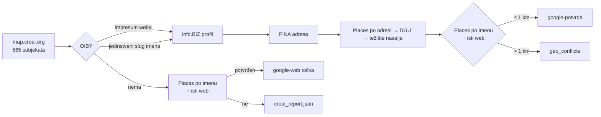

# Sloj AI ekosustav (CroAI) — 29.10.2026.

Sloj `croai` na gis.domovina.ai prikazuje Croatian AI Landscape s
map.croai.org. Gradi ga `apps/data-pipeline/scripts/34_fetch_croai.py`, a
frontend je `apps/karta-web/src/hooks/useCroaiLayer.ts`. Prvi build: **301 od
565** subjekata na karti. Lokalno je provjeren, **nije deployan**.

## Imenik nije članstvo

CroAI u pozivu za 5. izdanje mape (mail s `clanstvo@croai.org`, 29.10.2026.)
piše da je unos u imenik odvojen od formalnog članstva u udruzi. Na mapi su
A1, Addiko, 24sata, konferencije i sveučilišta, a privatnih članova nema. Zato
se sloj zove „AI ekosustav (CroAI)“, ne „članovi CroAI-ja“. Za upis na mapu
CroAI koristi Google Form iz tog maila.

## Izvor nema adrese

`POST https://map.croai.org/api/fetchEntities` s tijelom
`{"tableId":"tblCgVtW6pcjIja5q","baseId":"app2Fy0c82KqBtG0N"}` vraća stablo
od 3 grupe (Startups & Companies, Enablers & Extended Ecosystem, Early
Adopters), 27 potkategorija i 565 subjekata. Subjekt ima samo `name`,
`domain`, `logoURL`, `about` i `yearFounded`. `logoURL` je potpisani Airtable
URL koji istječe za nekoliko sati, pa se ne sprema.

Bez adrese sam geokoding ne pomaže. Lokacija ide preko identiteta (OIB), kao u
koraku 33.

## Kako se traži OIB, i zašto baš tako

1. **Impresum vlastitog weba.** Naslovnica i do 5 podstranica čiji put zvuči
   kao impresum, kontakt, o nama ili pravne informacije. OIB mora proći
   kontrolnu znamenku i postojati u info.BIZ indeksu. Označeni broj („OIB:“,
   „VAT“) vrijedi 3, goli broj 1. Kad stranica ima više OIB-a, pobjeđuje onaj
   čiji info.BIZ slug liči na ime ili domenu.
2. **Jedinstveni slug imena u info.BIZ indeksu** (318 899 subjekata).
   „Addiko Bank d.d.“ ima tri profila, pa se takav ne pogađa.

Mjerenja i zamke:

- **OIB agencije u podnožju** („Izrada: X d.o.o., OIB …“). OIB s oznakom se
  odbacuje ako u 160 znakova prije njega piše izrada, developed, design,
  powered, hosting i slično.
- **Pravilo „samo .hr domena“ bilo je preoštro.** Izbacilo je 41 ispravan
  pogodak (Sofascore → Sofa IT, Orqa, Marrow Labs, sveučilišta na `/en/`),
  pa je 310 palo na 261. Zamijenjeno je filtrom konteksta agencije iz točke
  iznad, i vratilo se na 301.
- **Kratko ime na stranoj domeni je loterija.** „Atos“ (atos.net) je u
  info.BIZ-u jedinstven kao lovačko društvo u Netretiću. Pogodak po imenu
  kraćem od 6 slova traži `.hr` domenu.
- Pogoci samo s weba (59) uglavnom su stvarni operateri brenda: T-portal → HT,
  Greyp → Porsche eBike Performance, Trikoder → Njuškalo. Ručno nisu
  provjereni svi.

Rezultat 29.10.: 150 OIB-a s weba uz poklapanje imena, 92 po imenu, 59 samo s
weba, 9 s OIB-om bez lokacije, 255 bez OIB-a.

## Geokod: tri ispada u jednom danu

- **DGU WFS** je vraćao HTTP 200 s XML-om „Service WFS is disabled“.
  `src/dgu.py` je to spremao u keš kao prazan rezultat. Popravljeno: odgovor s
  `ServiceUnavailable` se više ne kešira. Obrisano je 406 zatrovanih unosa.
- **Nominatim** je jedno vrijeme bio rezerva (147 točaka), pa je izbačen jer
  korisnik kaže da često griješi. Isto je zaključio i crkve.domovina.ai
  (presporo za masovni rad).
- **Google Places** (`src/places.py`, prilagođeno iz crkve.domovina.ai) vraća
  403 `PERMISSION_DENIED`. Ključ iz `crkve.domovina.ai/.env` isti je kao u
  rodjendaonice (GCP projekt 738176355812). Radio je 15.8.2026., a IP
  89.201.137.96 je na njegovoj allowlisti. Ključ iz klubovi.domovina.ai traži
  billing. Lokalni `gcloud` je servisni račun bez pristupa tom projektu, pa
  uzrok treba gledati u konzoli. Klijent na 401/403/429 isključi Places za
  taj run umjesto da sruši skriptu.

Posljedica: u trenutnom buildu 267 od 301 točke stoji na težištu naselja.
Popup to piše kao „Točnost: središte mjesta“.

## Dvostruka provjera preko Googlea (napisano, još nepokrenuto)

Places se pita dvaput: po FINA adresi (za točku na razini zgrade) i po imenu.
Pogodak po imenu vrijedi samo ako Googleov `websiteUri` ima isti host kao
CroAI domena. To je izvor koji nije sudjelovao u pronalasku OIB-a.

- ≤ 1 km od sjedišta → `provjera: google-potvrda`
- > 1 km → `google-sukob`. Točka ostaje FINA sjedište, a par ide u
  `croai_report.json → geo_conflicts` (sjedište kod knjigovođe ili krivi OIB).
- Subjekt bez OIB-a dobije Googleovu točku samo uz istu potvrdu weba
  (`google-web`).

Procjena je ~870 Text Search poziva. Keš je u `data/raw/places/`.

## Otvoreno

- [ ] Popraviti Places ključ u GCP konzoli, pa `rm -rf apps/data-pipeline/data/raw/places`
      i ponovno pokrenuti skriptu 34.
- [ ] Pregledati `geo_conflicts` i 59 pogodaka samo s weba.
- [ ] `data/croai_overrides.json` (`{croai_id: {oib | lat,lng | izvan_hr}}`) još
      ne postoji. Kandidati su strani subjekti (Bloomberg Adria, Adria Tech
      Forum) i subjekti bez OIB-a.
- [ ] Treća provjera OIB-a kod sukoba preko `~/git/domovinatv/company-details-api`
      (firme.domovina.ai v1: sudski registar, CompanyWall).
- [ ] Deploy: `node apps/karta-web/scripts/sync-data.mjs` pa `npm run deploy`
      u `apps/karta-web`.

## Vezani dokumenti

- `apps/data-pipeline/scripts/33_fetch_ppi_privatni.py`: isti obrazac
  „identitet je OIB“ za privatni ekosustav.
- `docs/2026-09-06-zagrebacki-otvoreni-podaci.md`
